<div align="center">



<br />

[**GITHUB ↗**](https://github.com/Bil3al) &nbsp; / &nbsp; [**LINKEDIN ↗**](https://www.linkedin.com/in/bilal-malih) &nbsp; / &nbsp; [**PROPOSER UN STAGE PFE ↗**](mailto:malihbilal32@gmail.com)

**Spring Boot · React · Agentic AI · RAG · Kubernetes**

</div>

## À propos / Du code aux systèmes utiles

Je suis **Bilal Malih**, élève ingénieur en **génie logiciel et sciences des données à l’ENSIAS**, au Maroc. J’aime concevoir des applications robustes, fiables et évolutives, du backend à l’interface, et y intégrer une IA qui répond à des besoins concrets.

Mes projets relient **développement full stack, systèmes multi-agents et recherche augmentée** : diagnostiquer des incidents Kubernetes, vérifier des assertions scientifiques ou faciliter la collaboration entre développeurs. Mes expériences m’ont aussi amené à travailler sur la computer vision pour la santé et l’automatisation de workflows.

**Je recherche un stage PFE** pour contribuer en équipe à des projets à fort impact en génie logiciel et IA appliquée. [Échangeons par email ↗](mailto:malihbilal32@gmail.com)

```yaml
bilal:
  formation: ENSIAS · Génie logiciel & sciences des données
  approche: comprendre le besoin → concevoir → construire → valider
  focus: [full stack, RAG agentique, systèmes multi-agents, observabilité]
  principes: [SOLID, architecture claire, travail en équipe]
```

## 01 / La stack en pratique



<details>
<summary><strong>Explorer les technologies et les concepts</strong></summary>

<br />

| Domaine | Technologies & concepts |
| :--- | :--- |
| **Langages** | Java · Python · JavaScript · TypeScript · SQL · HTML · CSS |
| **Backend & architecture** | Spring Boot · Spring Security · FastAPI · REST APIs · gRPC · microservices · RBAC |
| **Frontend** | React · WebSocket · interfaces temps réel · PWA |
| **IA & recherche** | LangGraph · Ollama · RAG · recherche hybride BM25 + vectorielle · reranking · DeBERTa-v3 · agents IA |
| **Machine learning** | Machine learning · deep learning · computer vision · détection de posture par NLI |
| **Données** | PostgreSQL · MySQL · MongoDB · Redis · Neo4j · Qdrant · ChromaDB |
| **Plateforme & observabilité** | Docker · Kubernetes · Helm · Trivy · Prometheus · Loki · Jenkins · CI/CD |
| **Pratiques & outils** | POO · SOLID · design patterns · JUnit · Git · GitHub · Jira · Agile |

</details>

## 02 / Projets sélectionnés

### InfraSentinel / Diagnostiquer les incidents Kubernetes

**AGENTIC AI × PLATFORM ENGINEERING · 2026**

Un agent IA qui corrèle **métriques Prometheus et logs Loki** pour diagnostiquer les incidents Kubernetes. La remédiation est assistée et soumise à une **validation humaine**.

L’architecture relie des microservices **Spring Boot et FastAPI par gRPC**, un dashboard React en temps réel et un pipeline CI/CD sécurisé sous Kubernetes avec Helm et Trivy.

`LangGraph` `RAG` `Qdrant` `Kubernetes` `Spring Boot` `FastAPI` `gRPC` `React`

---

### SciCheck AI / Vérifier les assertions scientifiques

**MULTI-AGENT SYSTEM × SCIENTIFIC RETRIEVAL · 2026**

Une plateforme de **RAG agentique entièrement locale**, qui vérifie des assertions à partir d’articles arXiv en informatique. Elle combine boucle active de recherche, **recherche hybride BM25 + ChromaDB + reranker**, détection de posture avec DeBERTa NLI et validation stricte des citations.

`Python` `LangGraph` `Ollama` `ChromaDB` `DeBERTa-v3` `FastAPI`



### Plateforme collaborative / Apprendre et construire ensemble

**FULL STACK × DEVELOPER COMMUNITY · 2026**

Une plateforme d’entraide technique avec **questions-réponses, votes et tags**, challenges de programmation, job board et espace de partage de connaissances.

`Spring Boot` `React` `TypeScript` `PostgreSQL` `REST API`

<div align="center">

[**EXPLORER MES REPOSITORIES ↗**](https://github.com/Bil3al?tab=repositories)

</div>

## 03 / Expériences de terrain

### MEDCONNECT / IA & computer vision pour la santé

**Juillet – septembre 2026**

Solution IA de triage pour une clinique dentaire : capture d’images, analyse en temps réel et score d’urgence clinique. Tri de la file d’attente, alertes praticien pour les cas critiques et mise en cache des analyses pour un fonctionnement hors ligne.

`Deep learning` `Computer vision` `DICOM` `JSON` `PWA`

### Enhanced Technologies / Gestion de projets augmentée

**Juin – août 2025**

Plateforme de gestion de projets et d’équipes : tâches, Kanban interactif, contrôle d’accès RBAC et notifications WebSocket. Moteur d’automatisation de workflows et assistant IA pour générer des tâches, analyser les risques et suivre les projets.

`Java 21` `Spring Boot` `React` `TypeScript` `PostgreSQL` `Redis` `Docker`

## 04 / Au-delà du code



- **Major de promotion**, 1er sur plus de 250 étudiants en licence sciences mathématiques et informatique.
- **2ᵉ place au hackathon D.A.T.A**, Data & AI Talents Assembly à l’INPT, en computer vision appliquée à la santé.
- **Membre de l’ENSIAS IT Club**, participation à l’organisation de plus de 10 événements : hackathons, conférences et formations.
- **Certifications** : Oracle Certified Associate Java SE 8 ; The Machine Learning Process A-Z — 365 Data Science.

### Parcours & langues

| Formation | Période |
| :--- | :--- |
| **ENSIAS** — Cursus du diplôme d’ingénieur d’État en génie logiciel et sciences des données | Depuis 2024 |
| **USMBA · Faculté Polydisciplinaire de Taza** — Licence fondamentale en sciences mathématiques et informatique, mention bien | 2023 – 2024 |

**Arabe** : natif &nbsp; / &nbsp; **Français** : courant &nbsp; / &nbsp; **Anglais** : intermédiaire

## 05 / Activité GitHub

<details>
<summary><strong>Ouvrir les statistiques et le graphe de contributions</strong></summary>

<br />

<div align="center">


</div>

*Ces visuels sont générés par des services externes et dépendent de leur disponibilité.*

</details>

<br />

> « La meilleure architecture est celle qui rend l’IA accessible, fiable et utile — pas juste impressionnante. »

<br />



<div align="center">

**[LinkedIn](https://www.linkedin.com/in/bilal-malih)** &nbsp; · &nbsp; **[malihbilal32@gmail.com](mailto:malihbilal32@gmail.com)** &nbsp; · &nbsp; **[GitHub](https://github.com/Bil3al)**

<sub>Bilal Malih · Neural Blueprint · Des idées aux systèmes.</sub>

</div>
